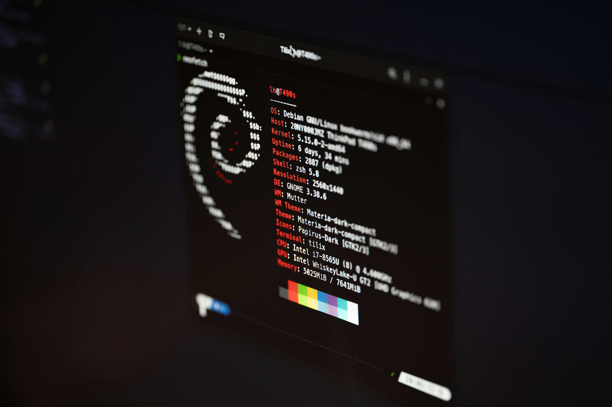

# 👋 Hi, I'm Zahaan Javaid Mahajan

### Software Engineer → DevOps | Cloud | Platform Engineering

  

  
  
  

---

## 🧑‍💻 About Me

I'm a Software Engineer transitioning into **DevOps, Cloud, and Platform Engineering**, focused on building reliable infrastructure, automating workflows, and improving how applications are deployed and operated.

- ☁️ Exploring **AWS, cloud networking, and Infrastructure as Code**
- ☸️ Building hands-on experience with **Kubernetes, Helm, and container orchestration**
- 🔄 Implementing **CI/CD pipelines and GitOps workflows**
- 🏗️ Provisioning infrastructure using **Terraform**
- 🐍 Writing Python scripts to automate infrastructure and operational tasks
- 🏠 Operating a Kubernetes homelab using **Proxmox and Talos Linux**
- 📦 Working with **Argo CD, MetalLB, Traefik, cert-manager, and NFS storage**
- 🐳 Building, securing, and publishing container images
- 📱 Bringing previous experience in **Flutter, Dart, and application development**

> **My approach:** Learn by building, understand by debugging, and improve by automating.

---

## 🛠️ Tech Stack

### ☁️ Cloud & Infrastructure

  

### ☸️ Containers & Platform Engineering

  
  
  
  

### 🔄 CI/CD, GitOps & Automation

  
  

### 🌐 Networking, Security & Observability

  
  
  
  
  

### 💻 Software Development

  

---

## 🚀 Featured Projects

### 🏠 Bare-Metal Kubernetes & GitOps Homelab

A self-hosted Kubernetes environment built to explore platform engineering, cluster operations, networking, storage, and GitOps.

- **Infrastructure:** Proxmox, Talos Linux
- **Orchestration:** Kubernetes, Helm
- **GitOps:** Argo CD, GitHub Actions
- **Networking:** MetalLB, Traefik, Cloudflare DNS
- **Security:** cert-manager, Let's Encrypt
- **Storage:** OpenMediaVault, NFS CSI

### 🖥️ DevOps Portfolio — GitOps Delivery

A terminal-inspired portfolio website deployed to my Kubernetes homelab, with application changes delivered through an automated workflow.

- Source control and CI with GitHub Actions
- Container image builds and registry publishing
- GitOps-based deployment using Argo CD
- Kubernetes-based application hosting
- Automated updates from repository changes

  
  

---

## 📊 GitHub Analytics

  
  

  

---

## 🌐 Connect With Me

  
  
  

---

  <i>Building. Automating. Debugging. Learning.</i>
   
  <b>One deployment at a time. 🚀</b>

