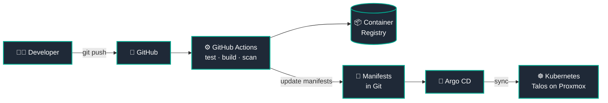
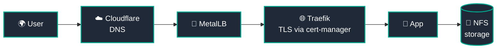

<!-- ===================== HEADER ===================== -->
<div align="center">


<a href="https://github.com/ZahaanMahajan">
  
</a>

<br/>

<a href="https://portfolio.zahaan.online"></a>
<a href="https://www.linkedin.com/in/zahan-mahajan-6bb365210/"></a>
<a href="https://medium.com/@zahaanjavaid032"></a>
<a href="https://instagram.com/zahaan_mahajan"></a>

<br/><br/>


</div>

<br/>

<!-- ===================== TERMINAL INTRO ===================== -->

```bash
zahaan@homelab:~$ whoami
Zahaan Javaid Mahajan — Software Engineer turning DevOps / Platform Engineer

zahaan@homelab:~$ cat mission.txt
Learn by building. Understand by debugging. Improve by automating.

zahaan@homelab:~$ kubectl get nodes
NAME            STATUS   ROLES           OS-IMAGE
talos-cp-01     Ready    control-plane   Talos Linux
talos-wk-01     Ready    <none>          Talos Linux

zahaan@homelab:~$ echo $STATUS
Shipping. Breaking. Fixing. Repeat. 🔁
```

---

## 🧑‍💻 About Me

I'm a software engineer **transitioning into DevOps, Cloud, and Platform Engineering**. I care about reliable infrastructure, repeatable deployments, and removing manual toil from the way software gets shipped and run.

<table>
<tr>
<td width="50%" valign="top">

### 🔭 What I'm working on
- ☁️ **AWS**, cloud networking & Infrastructure as Code
- ☸️ **Kubernetes**, Helm & container orchestration
- 🔄 **CI/CD** pipelines & **GitOps** workflows
- 🏗️ Provisioning with **Terraform**
- 🐍 Python scripts for infra & ops automation

</td>
<td width="50%" valign="top">

### 🏠 What I run at home
- 🖥️ Kubernetes homelab on **Proxmox + Talos Linux**
- 🚀 **Argo CD** for GitOps delivery
- 🌐 **MetalLB**, **Traefik**, Cloudflare DNS
- 🔐 **cert-manager** + Let's Encrypt
- 💾 **NFS** storage via OpenMediaVault
- 🐳 Building, scanning & publishing container images

</td>
</tr>
</table>

> 📱 **Background:** Before DevOps, I built apps with **Flutter, Dart, Java/Spring, and React**. That developer's-eye view is what shapes how I design pipelines and platforms today.

---

## 🛠️ Tech Stack

<div align="center">

### ☁️ Cloud & Infrastructure


### ☸️ Containers & Platform Engineering

<br/>


### 🔄 CI/CD, GitOps & Automation

<br/>


### 🌐 Networking, Security & Observability


### 💻 Software Development


</div>

---

## 🚀 Featured Projects

### 🏠 Bare-Metal Kubernetes & GitOps Homelab

A self-hosted Kubernetes platform built to explore cluster operations, networking, storage, and GitOps end to end.

**🚀 Delivery pipeline**



**🌐 Traffic flow**



| Layer | Technology |
|:--|:--|
| 🖥️ **Infrastructure** | Proxmox · Talos Linux |
| ☸️ **Orchestration** | Kubernetes · Helm |
| 🔄 **GitOps** | Argo CD · GitHub Actions |
| 🌐 **Networking** | MetalLB · Traefik · Cloudflare DNS |
| 🔐 **Security** | cert-manager · Let's Encrypt |
| 💾 **Storage** | OpenMediaVault · NFS CSI |

<br/>

### ⚙️ TaskFlow: Full-Stack App & DevOps Pipeline

A task management application built to practice production-style software delivery and cloud automation.

| Layer | Technology |
|:--|:--|
| 📱 **Application** | Spring Boot · React · PostgreSQL |
| 🐳 **Containers** | Docker · Docker Compose |
| 🔄 **CI/CD** | GitHub Actions |
| 🛡️ **Security** | Trivy · Automated testing |
| 📦 **Registry** | GitHub Container Registry |
| ☁️ **Infrastructure** | Terraform · AWS |
| 🚀 **Deployment** | Automated delivery workflows |

<br/>

### 🖥️ DevOps Portfolio: GitOps Delivery

A terminal-inspired portfolio hosted on my Kubernetes homelab. Every change to the repo flows through an automated path to production.

`📝 Commit` → `⚙️ GitHub Actions CI` → `🐳 Image Build & Publish` → `🚀 Argo CD Sync` → `☸️ Live on Kubernetes`

<div align="center">

<a href="https://portfolio.zahaan.online"></a>
<a href="https://github.com/ZahaanMahajan?tab=repositories"></a>

</div>

---

## 🗺️ Learning Roadmap

| Focus Area | Status |
|:--|:--|
| 🐧 Linux & Bash |  |
| 🐳 Docker & Containers |  |
| ☸️ Kubernetes & Helm |  |
| 🔄 CI/CD & GitOps |  |
| 🏗️ Terraform & AWS |  |
| 📈 Observability (Prometheus, Grafana) |  |

---

## 📊 GitHub Analytics

<div align="center">


<br/><br/>


## 🟢 Contribution Activity

<p align="center">
  
</p>


<br/>

<!-- Contribution snake: requires the snake.yml workflow (see setup notes) -->
<picture>
  <source media="(prefers-color-scheme: dark)" srcset="https://raw.githubusercontent.com/ZahaanMahajan/ZahaanMahajan/output/github-snake-dark.svg" />
  <source media="(prefers-color-scheme: light)" srcset="https://raw.githubusercontent.com/ZahaanMahajan/ZahaanMahajan/output/github-snake.svg" />
  
</picture>

</div>

---

## 🌐 Let's Connect

<div align="center">

I'm always happy to talk about **DevOps, Kubernetes, homelabs, and platform engineering**.
If you're hiring, collaborating, or just curious about the stack, say hello.

<a href="https://www.linkedin.com/in/zahan-mahajan-6bb365210/"></a>
<a href="https://portfolio.zahaan.online"></a>
<a href="https://medium.com/@zahaanjavaid032"></a>
<a href="https://instagram.com/zahaan_mahajan"></a>

<br/><br/>

<i>Building. Automating. Debugging. Learning.</i>
<br/>
<b>One deployment at a time. 🚀</b>

</div>


